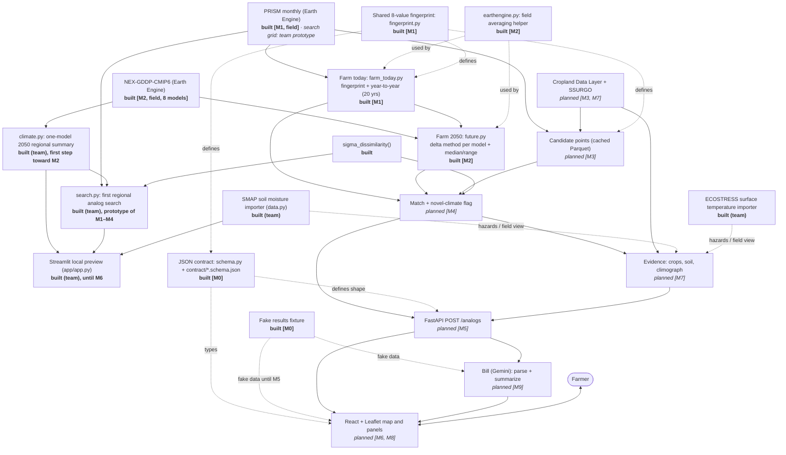

# Architecture

Must always match the code on this branch. See rule 5 in [HOW_WE_BUILD.md](HOW_WE_BUILD.md).

Legend: **built** = exists in code; _planned_ = not yet built (milestone in brackets).

**Also built:** conda environment (`environment.yml`), setup guide (`SETUP.md`), project layout (`src/farm_analog/`, `app/`, `notebooks/`), settings (`config.py`, M0), `pyproject.toml` with pytest and ruff (M0), CI for the backend (`.github/workflows/ci.yml`, M0).

Dotted arrows are build-time relationships (shared types and fake data), not runtime data flow.

## Changelog

- 2026-11-14 (M2): Added `future.py` (per-model delta method at the farm, ensemble median and range, Earth Engine fetch of model climatologies) and `earthengine.py` (shared field averaging). `config.CLIMATE_MODELS` lists 8 models. `search.py` uses the shared delta functions (rankings unchanged).

- 2026-11-14 (M1): Added `fingerprint.py` (one 8-value quarterly definition) and `farm_today.py` (PRISM for a drawn field via Earth Engine, plus offline-tested processing). Contract switched to the 8 values; settings switched to IPCC AR6 periods; the Palouse box moved to `config.py`; `search.py` uses the shared definitions and runs from cache without Earth Engine.

- 2026-11-14 (M0 second rebase): Added the team's `search.py`, a working regional prototype of M1–M4 (PRISM 1995–2014 + ACCESS-CM2 delta + sigma dissimilarity on a 20 km grid), feeding the Streamlit preview.
- 2026-11-14 (M0 rebase): Added the team's SMAP and ECOSTRESS importers, the one-model 2050 summary (`climate.py`) and the Streamlit preview. Importers feed the evidence step later (M7).
- 2026-11-14 (M0): Added the JSON contract (Pydantic models exported to JSON Schema), the fake-results fixture, settings, test and lint setup, and backend CI.
- 2026-11-14: Initial graph. Built: environment setup and `sigma_dissimilarity()`. Everything else planned (M1–M10).
