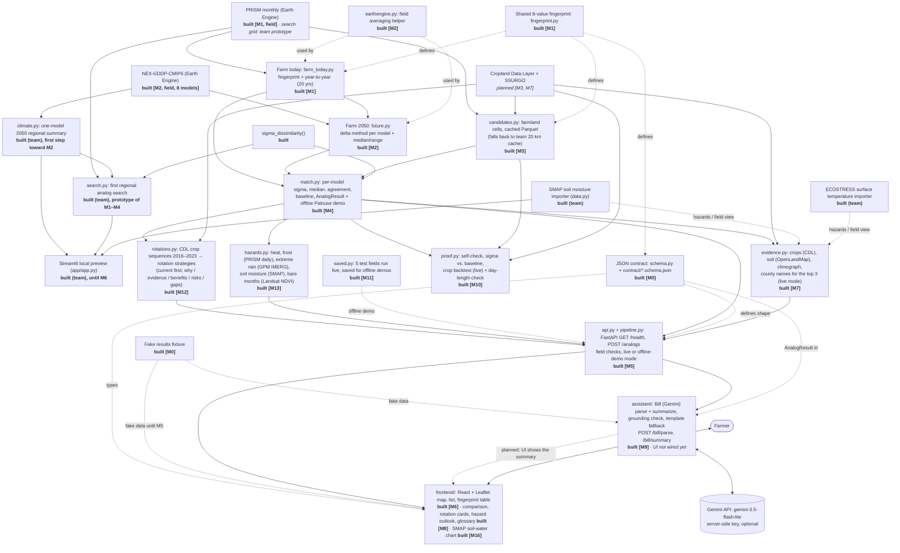

# Architecture

Must always match the code on this branch. See rule 5 in [HOW_WE_BUILD.md](HOW_WE_BUILD.md).

Legend: **built** = exists in code; _planned_ = not yet built (milestone in brackets).

**Also built:** conda environment (`environment.yml`), setup guide (`SETUP.md`), project layout (`src/farm_analog/`, `app/`, `notebooks/`), settings (`config.py`, M0), `pyproject.toml` with pytest and ruff (M0), CI for the backend (`.github/workflows/ci.yml`, M0).

Dotted arrows are build-time relationships (shared types and fake data), not runtime data flow.

## Changelog

- 2026-11-15 (M16): The comparison panel shows SMAP root-zone soil moisture: a driest-month row in the hazard table and a monthly chart (field vs. match). Frontend only; the data was already in the M13 results.

- 2026-11-15 (M8): The frontend shows rotation cards, a comparison of the selected match (monthly climate chart, crops, soil, hazard outlook), Bill's plain-language summary and a glossary.

- 2026-11-15 (M11–M13): Live run with Earth Engine (candidate cache: 3,351 farmland cells; 5 test fields moved onto cropland and saved for offline use in `saved.py`; live backtest). `rotations.py` (M12) adds rotation strategies and `hazards.py` (M13) adds heat, frost, extreme rain, soil moisture and bare months; both are optional steps in the live pipeline. Contract gains `rotations`, `farm_hazards` and `Analog.hazards`.

- 2026-11-14 (M10): Added `proof.py` (self-check, sigma vs. standardized-distance agreement, model agreement, crop-mix backtest with Earth Engine) and the day-length check in the live pipeline (`candidates.near_latitude`). M8 skipped for now (no UI changes).

- 2026-11-14 (M9): Added Bill (`assistant/`): a text → `FarmProfile` parser using Gemini structured output, and a summarizer that sends derived numbers only (no coordinates), checks every number in the reply against its input, and falls back to a template. Plus a prompt-injection guard, and `POST /bill/parse` and `POST /bill/summary` in `api.py` (Gemini set up once at startup, optional; summaries cached). Bill's models stay out of `contract/`. The frontend isn't changed.

- 2026-11-14 (M7): Added `evidence.py` (crop shares from CDL, OpenLandMap soil, monthly climographs, county names) attached to the top 3 analogs in live mode; `FarmToday` keeps its monthly table and `FarmFuture` its per-model changes; the live pipeline returns the match even if evidence fails.

- 2026-11-14 (M6): Added `frontend/` (Vite + React + TypeScript, react-leaflet + Geoman drawing, types generated from `contract/`, demo-data fallback, accessible results list) and a frontend CI job.

- 2026-11-14 (M5): Added `pipeline.py` (field checks, live analysis with Earth Engine, offline Palouse demo otherwise) and `api.py` (FastAPI `GET /health`, `POST /analogs`, CORS, privacy-safe caching and errors). Environment gains fastapi, uvicorn, httpx, shapely, pyproj.

- 2026-11-14 (M4): Added `match.py` (sigma per model, median, model agreement, standardized-distance baseline, `AnalogResult` output) and an offline Palouse demo from the team's data that reproduces the team's rankings. Contract gains optional `notes`.

- 2026-11-14 (M3): Added `candidates.py`: farmland PRISM cells in the inland Northwest with the shared fingerprint and cultivated share, fetched in tiles from Earth Engine and cached as Parquet; offline fallback to the team's 20 km cache. Search area set in `config.SEARCH_BBOX`.

- 2026-11-14 (M2): Added `future.py` (per-model delta method at the farm, ensemble median and range, Earth Engine fetch of model climatologies) and `earthengine.py` (shared field averaging). `config.CLIMATE_MODELS` lists 8 models. `search.py` uses the shared delta functions (rankings unchanged).

- 2026-11-14 (M1): Added `fingerprint.py` (one 8-value quarterly definition) and `farm_today.py` (PRISM for a drawn field via Earth Engine, plus offline-tested processing). Contract switched to the 8 values; settings switched to IPCC AR6 periods; the Palouse box moved to `config.py`; `search.py` uses the shared definitions and runs from cache without Earth Engine.

- 2026-11-14 (M0 second rebase): Added the team's `search.py`, a working regional prototype of M1–M4 (PRISM 1995–2014 + ACCESS-CM2 delta + sigma dissimilarity on a 20 km grid), feeding the Streamlit preview.
- 2026-11-14 (M0 rebase): Added the team's SMAP and ECOSTRESS importers, the one-model 2050 summary (`climate.py`) and the Streamlit preview. Importers feed the evidence step later (M7).
- 2026-11-14 (M0): Added the JSON contract (Pydantic models exported to JSON Schema), the fake-results fixture, settings, test and lint setup, and backend CI.
- 2026-11-14: Initial graph. Built: environment setup and `sigma_dissimilarity()`. Everything else planned (M1–M10).
